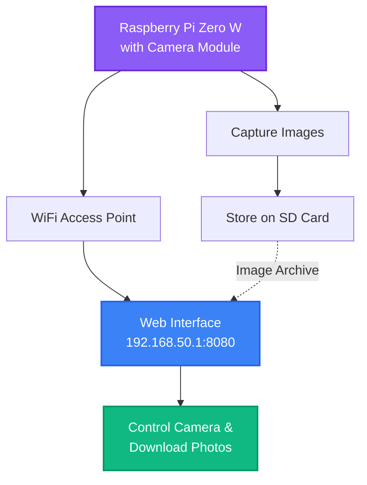
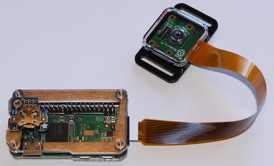

[](https://github.com/ingojaeckel/go-raspberry-pi-timelapse/actions?query=workflow%3ABuild)
[](https://github.com/ingojaeckel/go-raspberry-pi-timelapse/releases/latest)

# Go Raspberry Pi Timelapse

This repository contains documentation and source code to help running a [Raspberry Pi Zero](https://www.raspberrypi.org/products/raspberry-pi-zero-w/) based timelapse camera.

## How does it work?



**System Overview:**
1. 🎥 Raspberry Pi Zero W with Camera Module captures images at scheduled intervals
2. 💾 Images are stored locally on the SD card
3. 📡 Pi creates a WiFi hotspot for wireless access
4. 🌐 Built-in web interface for camera control, preview, and image downloads
5. ⏰ Automated scheduling for hands-free operation



## Quick start

1. From another computer, download the `.zip` image of the [most recent go-raspberry-pi-timelapse release](https://github.com/ingojaeckel/go-raspberry-pi-timelapse/releases) (or build one with `make image`, see [docs/installer.md](docs/installer.md)).
2. Write it to an empty SD card with the [Raspberry Pi Imager](https://www.raspberrypi.com/software/): choose "Use custom" and the `.zip`, and skip the OS customisation (the image already contains the user, SSH and Wi-Fi settings).
3. Insert the SD card card into the Pi Zero W.
4. Turn on the Pi Zero W plugging in a micro USB cable into the PWR IN connector (bottom right corner).
5. The Pi Zero W will act as a Wifi access point. Connect to the Pi's Wifi named `timelapse-raspberry-pi`, passphrase: `InsertTheRealPassword`.
6. Open the Pi's web interface in a browser: `http://192.168.50.1:8080/`. This interface will allow you to align the camera, download photos, shutdown the Pi, etc.

For the parts list and assembly steps, see [docs/hardware.md](docs/hardware.md).

## Development

Requires Go (see `src/backend/go.mod`), Node (see `src/frontend/.nvmrc`), and `make`.

```bash
make            # frontend build + tests, Go vet + tests, development build
make pi         # same, then cross-compile for the Pi Zero W
make pi64       # same, but for 64-bit Raspberry Pi OS (Pi Zero 2 W, 3, 4, 5), to copy to a Pi by hand
make image      # make pi, then build the SD card image (requires Docker), see docs/installer.md
make run        # build the frontend and run the server on http://localhost:8080
make loadtest   # k6 load test against a local build (requires k6)
```

The Go binary embeds the frontend. Vite writes its build into `src/backend/web/dist`, which `src/backend/web` embeds via `//go:embed`. Every Go target in the `Makefile` therefore builds the frontend first.

## Repository layout

```
docs/                    documentation and images
src/backend/             Go server (go.mod lives here)
src/frontend/            React + Vite web UI, built into src/backend/web/dist
src/installer/           CustomPiOS image build (custompios/, make image)
src/perf-testing/k6/     k6 load tests and runner script
```

## Documentation

- [Hardware: parts and build](docs/hardware.md)
- [Installer: building the Pi disk image](docs/installer.md)
- [Frontend](src/frontend/README.md)
- [Load testing and profiling](docs/load-testing.md) ([implementation notes](docs/load-testing-implementation.md))
- [Go benchmarks](docs/benchmarks.md)
