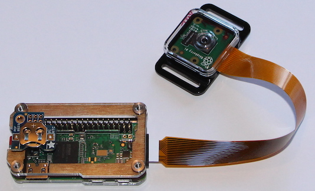

# Hardware: parts and build

## Parts list

This project was created for a timelapse system consisting of the following core components: a Pi Zero W with a camera board, a case, and an SD card. The following sections describe the components in more detail.

### Core parts for regular deployment (about $65)

* [Raspberry Pi Zero W](https://www.adafruit.com/product/3400) ($10)
* [Raspberry Pi Camera Board v2](https://www.adafruit.com/product/3099) ($30)
* [Raspberry Pi Zero Camera Cable](https://www.adafruit.com/product/3157) ($6)
* [C4Labs Zebra Zero Case](https://www.adafruit.com/product/3003) ($7)
* [microSDHC Card](https://www.adafruit.com/product/2767) ($12)

### Additional parts to include a battery backed clock (about $8)

* [Break-away 0.1" 2x20-pin Strip Dual Male Header](https://www.adafruit.com/product/2822) ($1)
* [CR1220 12mm Diameter - 3V Lithium Coin Cell Battery](https://www.adafruit.com/product/380) ($1)
* [Adafruit PiRTC - PCF8523 Real Time Clock for Raspberry Pi](https://www.adafruit.com/product/3386) ($6)

### Additional Parts for Development (about $6)

* [USB OTG Host Cable - MicroB OTG male to A female](https://www.adafruit.com/product/1099) ($3)
* [Mini HDMI Plug to Standard HDMI Jack Adapter](https://www.adafruit.com/product/2819) ($3)

## Build overview

### Build steps

#### Step 1: Initial Build

1. Optional: If you want to use the battery backed clocked start by soldering the 2x20-pin strip on Pi Zero W board ([instructions](https://learn.adafruit.com/adding-a-real-time-clock-to-raspberry-pi/wiring-the-rtc)). After the soldering, attach the RTC to the 2x20-pin strip. Don't forget to insert the CR1220 battery into the RTC. After installing the image (step 2), enable and set the clock as described in [docs/installer.md](installer.md#real-time-clock).
2. Connect the Pi Zero W and the Pi Camera Board v2 via the Pi Zero Camera cable.
3. Insert the Pi Zero W into the C4Labs Zerbra Zero Case.

#### Step 2: Install disk image and access web interface

1. From another computer, download the `.zip` image of the [most recent go-raspberry-pi-timelapse release](https://github.com/ingojaeckel/go-raspberry-pi-timelapse/releases) (or build one with `make image`, see [docs/installer.md](installer.md)).
2. Write it to an empty SD card with the [Raspberry Pi Imager](https://www.raspberrypi.com/software/): choose "Use custom" and the `.zip`, and skip the OS customisation (the image already contains the user, SSH and Wi-Fi settings).
3. Insert the SD card card into the Pi Zero W.
4. Turn on the Pi Zero W plugging in a micro USB cable into the PWR IN connector (bottom right corner).
5. The Pi Zero W will act as a Wifi access point. Connect to the Pi's Wifi named `timelapse-raspberry-pi`, passphrase: `InsertTheRealPassword`.
6. Open the Pi's web interface in a browser: `http://192.168.50.1:8080/`. This interface will allow you to align the camera, download photos, shutdown the Pi, etc.

## Other Pis and cameras

* The image is 32-bit (armhf) and also runs on a Pi Zero 2 W. Its CPU runs at its lowest clock, 600 MHz (700 MHz on a Pi Zero W), see [power profiles](installer.md#power-profiles).
* The resolutions in Settings are the 4:3 sizes of the Camera Module v2 (3280×2464 sensor). With a sensor of another aspect ratio, such as the 16:9 Camera Module 3, `rpicam-still` crops the image to 4:3 (a narrower field of view) rather than stretching it.

## Power management boards (not supported yet)

The Pi Zero cannot sleep, so the only large power saving is cutting its power between photos: a board with its own real-time clock powers the Pi off and wakes it on a schedule. At one photo every 30 minutes, booting and capturing for under a minute instead of idling saves roughly 95 % (estimate). The access point and web UI are then only reachable while the Pi is awake. The app would need a capture-once mode for this; it does not have one yet. The image's power profiles (see [docs/installer.md](installer.md#power-profiles)) are the savings available without extra hardware.

PiJuice from Pi Supply (software and docs: [github.com/PiSupply/PiJuice](https://github.com/PiSupply/PiJuice)) has an RTC with wake-up on a calendar event, software power off, and a deep-sleep state while the Pi is off. As of November 2026 Core Electronics lists both boards as retired; check stock and whether the PiJuice software supports the current Raspberry Pi OS before buying.

* [PiJuice Zero](https://core-electronics.com.au/pijuice-zero-a-portable-power-platform-for-raspberry-pi-zero.html): pHAT size for the Pi Zero W, takes a single-cell LiPo with NTC (no battery included; about 2000 mAh recommended).
* [PiJuice HAT](https://core-electronics.com.au/pijuice-hat.html): full HAT size for 40-pin Pis, 1820 mAh battery included.

## PiTFT
* https://learn.adafruit.com/adafruit-pitft-28-inch-resistive-touchscreen-display-raspberry-pi/easy-install-2 - Follow steps and `PiTFT as HDMI Mirror (Best for Raspberry Pi OS with Desktop)`
* https://learn.adafruit.com/running-opengl-based-games-and-emulators-on-adafruit-pitft-displays/tuning-performance
* https://willhaley.com/blog/power-off-raspberry-pi-adafruit-tft-screen-shutdown/
* Streaming raspivid output via network. (1) on the receiving device: `vlc -vvv udp://@:1234 :demux=h264`. (2) on the Pi: `raspivid -t 60000 -o udp://192.168.0.123:1234`.
